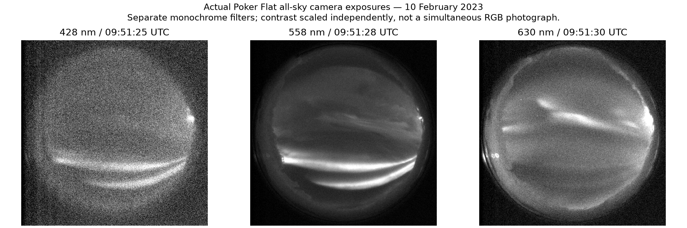
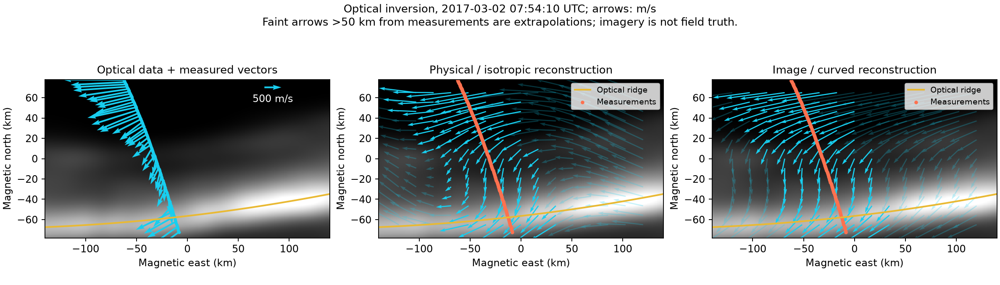
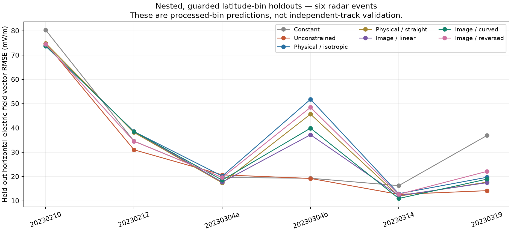
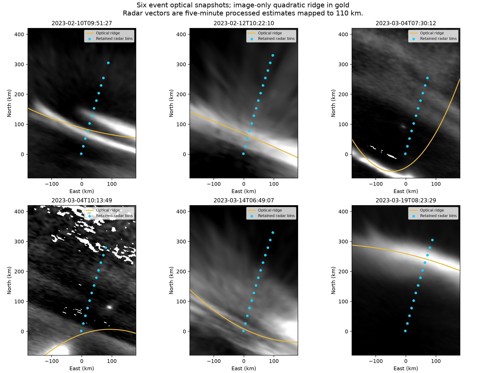

# Application to public auroral measurements and photography

**Executed 2026-10-18. Conclusions before any paper drafting.**

The public data application works technically: actual auroral camera products now inform physical field models, and measured observations are withheld from fitting and tuning. The results do **not** establish that image geometry reliably improves reconstruction. The simpler unconstrained model wins on the six-event radar aggregate; the physical model helps the full rocket track, while its image geometry adds no improvement.

## What is connected

- ISINGLASS processed sounding-rocket flow and the corresponding 2017 optical energy-flux inversion: 130 of 195 measurements fall inside the optical map.
- Six Swarm-over-Poker campaign conjunctions: 76 retained PFISR latitude-bin electric-field estimates, matched to DASC calibrated 428 nm imagery and its 110 km geographic registration. This benchmark does not use satellite drift as test truth.
- Three actual camera PNG exposures at 428, 558 and 630 nm, displayed separately. No generated auroral imagery is used.
- 17 publicly downloadable files, 576.6 MB, pinned by SHA-256. [Provenance, methods and references](README.md).

## Rocket result: physics helps this full track, geometry does not

| Model | Held-out vector RMSE (m/s) | Conditional 95% ellipse coverage |
|---|---:|---:|
| Constant | 721.0 | — |
| Unconstrained | 432.1 | 52.3% |
| Divergence-free, isotropic | 338.4 | 60.8% |
| Divergence-free, straight anisotropy | 348.6 | 59.2% |
| Divergence-free, image curvature | 358.1 | 59.2% |

The physical kernel reduces RMSE by **21.7%** relative to the unconstrained kernel on guarded contiguous holdouts. The optical version raises RMSE by **5.8%** relative to the isotropic physical model. These are same-track predictions, not proof of accuracy between tracks.

The image-model 95% ellipses cover only **59.2%** of held-out vectors under the provisional error model. Its uncertainty is strongly undercalibrated. A physically constrained covariance does not automatically deliver trustworthy uncertainty.

## Radar result: mixed event effects, no aggregate advantage

| Event (UTC date / crossing) | Unconstrained | Physical isotropic | Image curved |
|---|---:|---:|---:|
| 20230210 | 74.78 | 73.67 | 73.76 |
| 20230212 | 30.99 | 38.52 | 38.49 |
| 20230304a | 20.67 | 20.18 | 18.52 |
| 20230304b | 19.20 | 51.79 | 39.91 |
| 20230314 | 12.65 | 12.93 | 10.95 |
| 20230319 | 14.16 | 19.68 | 18.91 |
| Equal-event mean RMSE | **28.74** | 36.13 | 33.42 |

Units are mV/m. The mean is the arithmetic mean of the six event RMSE values, not the square root of pooled MSE.

Image geometry improves on the unconstrained model in **3/6 events**, but its equal-event mean RMSE is **16.3% worse**. Its event-mean MSE is also worse (1555.9 versus 1285.0 (mV/m)²). Against the isotropic physical model it reduces mean RMSE by 7.5%, which does not make it the best comparator.

## Why the optical link is not yet a reliable predictor

The image-only quadratic ridge works visually on several coherent arcs. It is poor for the two March 4 examples: disconnected/truncated bright structures and competing arcs are forced into one curve. Optical ridge residuals are about 70 and 40 km. This is an exposed failure of the simple extraction model, not evidence that photography cannot help. Other events can still fail even with a visually good ridge.

The fixed 4:1 correlation-length ratio and assumed relation between a brightness ridge and flow structure are additional model assumptions. The straight, linear-image and reversed-image controls are retained in the complete table. This study does not exhaust better segmentations or uncertainty-aware geometry models.

## Time and quality sensitivity

Decoding the MATLAB datetime payload resolved the rocket timing and recovered a source warning about its approximate geomagnetic vector rotation. The main optical snapshot is 07:54:10 UTC; the full selected track spans several minutes. After this audit, a post-hoc test restricted observations to +/-30 seconds of four optical snapshots:

| Optical snapshot UTC | Samples | Unconstrained | Physical isotropic | Image curved |
|---|---:|---:|---:|---:|
| 07:52:40 | 28 | 446.3 | 479.4 | 478.9 |
| 07:53:25 | 28 | 280.9 | 221.5 | 317.9 |
| 07:54:10 | 29 | 320.2 | 302.6 | 303.4 |
| 07:54:55 | 29 | 483.4 | 514.8 | 552.6 |

Units are m/s. These short, overlapping windows yield mixed outcomes. They reinforce the absence of a robust image-geometry benefit and are not four independent events. Rocket noise assumptions of 50 and 200 m/s, other full-track image snapshots, and radar error thresholds of 20 and 50 mV/m are retained in [sensitivity.csv](results/sensitivity.csv).

The radar quality threshold materially affects some absolute errors. For example, reducing the threshold removes a large February 10 excursion. Reported gains must therefore be read with the retained-bin lists and sensitivity results, not just the headline average.

## What can and cannot be concluded

**Established here:** public Lynch-group data can be ingested reproducibly; camera geometry can enter a physical kernel without replicating measurements; guarded holdouts expose failures that smooth maps conceal; conditional uncertainty can be quantitatively overconfident.

**Not established:** a new interpolation formula, a reliable image-driven improvement, calibrated two-dimensional uncertainty, independent-track accuracy, or a reproduction outperforming the published 2024 reconstruction method.

The next worthwhile experiment is a multi-arc geometry model with uncertainty, tested against a separately withheld spacecraft/rocket track or independent instrument through its actual averaging operator. The present radar products average roughly five minutes and are already inversion outputs; their bins are not independent raw measurements. The existing Swarm quality/mapping issue has not been bypassed.

## Evidence and reproduction

- [Every primary held-out prediction](results/predictions.csv), [event metrics](results/event_metrics.csv), [outer split membership and selected hyperparameters](results/selections.json), [data/timing/geometry metadata](results/data_metadata.json).
- [Rocket uncertainty and model disagreement](figures/isinglass_uncertainty.png), [radar uncertainty and model disagreement](figures/20230210_uncertainty.png). Exported `*_field_map.npz` files contain coordinates, two model means, conditional latent covariance matrices, and distance to the nearest measurement.
- 1,442 primary held-out prediction rows, 49 event/model summaries, 9 passing numerical/data tests, 17 verified source hashes. [Integrity checks](results/verification.json).
- [Methods and commands](README.md). Run `fetch.py`, the unit tests, `run.py --sensitivity`, and `summarize.py`. No manuscript has been drafted.
