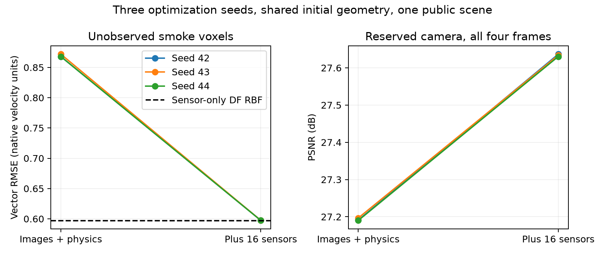
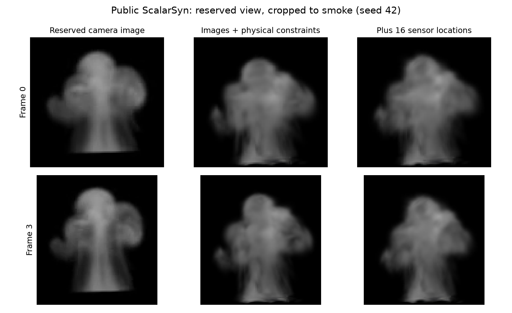
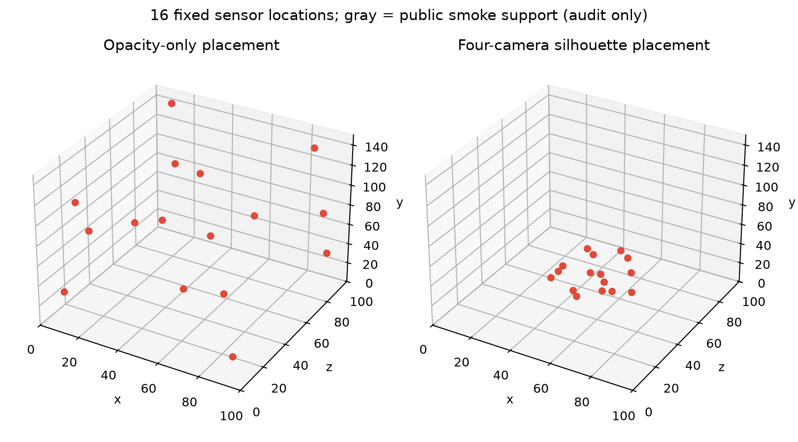
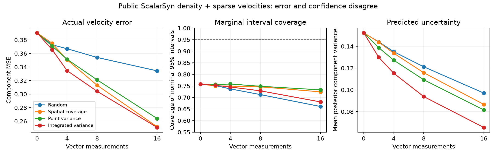

# Gaussian reconstruction: conclusions before a manuscript

**2026-10-18. Exploratory public-data experiments, not a submission-ready method.**

We now have an actual camera-based fluid reconstruction experiment. Image-informed placement of 16 simulated velocity sensors reduces the Gaussian model's withheld motion error by **31.3%** in the four-frame pilot. However, a conventional divergence-free RBF using the same sensor readings matches that result, and performs better over ten frames. The evidence supports investigating **where measurements resolve motion ambiguity**, but does not establish a Gaussian-specific motion advantage or a new reconstruction algorithm.

This distinction matters: one sensor layout makes the rendered images better while making motion **35.3% worse**. Rendering fidelity alone is an inadequate validation target for a scientific motion reconstruction.

## 1. What was actually executed

We ran the official [LagrangianSplats implementation](https://github.com/taoningxiao/LagrangianSplats), pinned at `180f61a8b56a39f3a71df168c54c87669081acff`, on its public [ScalarSyn images and reference volumes](https://huggingface.co/datasets/tnx123/LagrangianSplats-Dataset). This follows the earlier direct-velocity experiments in `gaussian_transport`; the present study really trains from camera images and renders a reserved view.

Four cameras train the initial Gaussian geometry and subsequent motion; a fifth camera is reserved. Three optimization seeds share the same initial geometry fitted at frame zero. The primary sequence has four frames and three velocity intervals. A ten-frame sensitivity run uses one seed. These are reduced-budget runs: 3,000 initial geometry iterations, 200 joint optimization epochs, approximately 1,121 sampled velocity-kernel centers, one window. They are not a full reproduction of the published benchmark.

Sensor locations are chosen from initial image-fitted Gaussian centers whose projections lie inside the four training-camera silhouettes. Farthest-point selection spreads 16 locations through this candidate set. Only after placement do we sample released reference velocities and add component noise of standard deviation 0.05. Thus the four-frame condition supplies **16 locations × 3 times = 48 vector readings**; ten frames supply 144. The readings are simulated instruments, not measured laboratory data.

Every model is evaluated at the same 4,096 withheld smoke voxels per interval, each more than two voxels from **all** sensor layouts. Reference velocity is never used to choose the image-experiment locations or tune the conventional comparator. Full conventions, exploratory changes and limitations are in [METHODS.md](METHODS.md).

## 2. The simple comparator changes the interpretation

Numbers below are means of per-frame vector RMSE, in native simulation units. Three-seed rows average optimization seeds, not independent scenes. All rows within each horizon use identical withheld vectors.

| Motion estimator | Four frames | Ten frames |
|---|---:|---:|
| Gaussian reconstruction: images + upstream physical losses | 0.8693 | 0.8744 |
| Same model + image-supported spatial-coverage sensors | **0.5974** | **0.7639** |
| Conventional DF RBF, same sensor readings only | **0.5967** | **0.6666** |
| Independent-component RBF, same sensor readings only | 0.6286 | 0.7295 |

The sensor-assisted Gaussian improves over its image-only baseline by **31.3%** over four frames and **12.6%** over ten. Four-frame gains occur for all three optimization seeds. But the DF sensor-only fit is effectively tied in the first case and has **12.7% lower error** than the joint Gaussian in the second. Sensor-only hyperparameters are selected by four-fold CV on the 16 supplied readings, with no temporal image loss or withheld motion labels. Its sensor *positions* remain image-informed.

The ten-frame experiment is not a prediction of unseen future time: those ten frames participate in training. It is a longer reconstruction horizon. Its smaller benefit cannot be assigned uniquely to time horizon, optimization budget, model mismatch or accumulated transport error without additional controls.

| Reserved-camera metric | Four-frame baseline | Four-frame + sensors | Ten-frame baseline | Ten-frame + sensors |
|---|---:|---:|---:|---:|
| Full-frame PSNR, dB | 27.193 | 27.634 | 26.828 | 27.357 |
| Smoke bounding-box PSNR, dB | 19.178 | 19.619 | 19.262 | 19.796 |
| Smoke bounding-box relative RMSE | 0.4863 | 0.4637 | 0.4853 | 0.4572 |

The foreground check prevents the large black background from hiding image error. It uses saved 8-bit images and is separate from the upstream floating-point full-frame metric. The conventional RBF comparator does not render images, so this study does not claim an appearance comparison against it.

Evidence: [common motion scores](results/common_motion.csv), [all image conditions](results/image_summary.csv), [sensor-only scores](results/sensor_only.csv), [foreground scores](results/image_roi.csv). Earlier layout-specific samples remain in the original JSON files for traceability; the common-target scores supersede them.

A post-fit [directional error audit](results/motion_components.csv) uses the released density gradient to split errors normal and tangent to density contours. It retains the upper 70% of gradient magnitudes within each common target set, so these are different subset metrics from the full RMSE table. In the four-frame case, sensors reduce normal MSE from 0.2260 to 0.0947 and two-dimensional tangent MSE from 0.5806 to 0.2930. The sensor-only RBF gives 0.0798 and 0.2958 respectively. Improvement occurs in **both** components; the evidence does not support attributing the entire gain to resolving an image nullspace. Over ten frames the conventional RBF is better in both components. Reference density is used only for this diagnostic, not to construct a fused prediction. Instantaneous density tangency is also not proof of indistinguishability under the full temporal renderer and physical losses.

## 3. Placement matters, and image quality can mislead

The initial opacity-times-volume placement picked almost entirely empty space. Multiplying by the fitted DC brightness did not change the selected locations in this pilot. Four-camera silhouette filtering produced a different candidate pool and substantially better coverage of visible smoke.

| Four-frame condition | Optimization seeds | Mean vector RMSE | Reserved-view PSNR, dB |
|---|---:|---:|---:|
| Images only, primary baseline | 3 | 0.8693 | 27.193 |
| Opacity-only sensors, weight 0.01 | 3 | 0.8623 | 27.227 |
| Opacity-only sensors, weight 1 | 3 | 0.7986 | 27.237 |
| Silhouette-supported spatial coverage, weight 1 | 3 | **0.5974** | **27.634** |
| Silhouette-supported random layout 413 | 3 | 0.8545 | 27.298 |
| Random layout 414 | 1 | 0.8585 | 27.612 |
| Random layout 415 | 1 | **1.1748** | **27.405** |
| Random layout 416 | 1 | 0.8329 | 27.534 |
| Random layout 417 | 1 | 0.8714 | 27.542 |

The opacity weight-1 runs have separately retrained image baselines, with RMSE 0.8704. The visual and random conditions reuse the original primary baseline; for seed 42 alone it has RMSE 0.8680 and PSNR 27.191. Reused baselines are not independent trials.

Random layout 415 improves PSNR by 0.213 dB while increasing motion RMSE from 0.8680 to 1.1748. The other random layouts are retained, so this is a documented failure example, not an estimate that all random layouts worsen motion. At seed 42, the five random layouts average 0.9185 RMSE. Their sample is too small and too scene-specific to establish a general placement law.

The useful contribution at this stage is a controlled diagnostic: **better pictures can accompany worse scientific motion estimates, and inexpensive spatial coverage is a serious baseline**. Neither silhouette intersection nor farthest-point sampling is new.

## 4. Posterior variance is not calibrated motion uncertainty

A separate CPU experiment studies Gaussian conditioning and standard greedy integrated-variance sensor selection on released three-dimensional density volumes. This is **not** uncertainty estimated from the camera-trained Gaussian splats. It uses four correlated snapshots of the same simulation, ten sampling seeds, and five covariance/noise settings. There are 12,000 metric rows, not 12,000 independent experiments.

Primary results use 256 scalar density-advection observations, up to 16 vector sensors, and 256 distinct withheld targets. Selection sees integration-target coordinates but never their velocity labels; this is a transductive design experiment.

| Design | MSE, 8 sensors | 95% interval coverage | MSE, 16 sensors | 95% interval coverage |
|---|---:|---:|---:|---:|
| Random | 0.3541 | 71.2% | 0.3343 | 66.1% |
| Farthest spatial coverage | 0.3131 | 74.6% | 0.2518 | 72.4% |
| Largest pointwise variance | 0.3211 | 74.8% | 0.2640 | 73.3% |
| Integrated posterior variance | 0.3042 | **72.9%** | 0.2508 | **68.1%** |

Integrated variance lowers MSE relative to random by **14.1%** at eight sensors and **25.0%** at sixteen. Relative to farthest coverage the gains are only **2.84%** and **0.39%**; conditional bootstrap intervals include zero (−1.11% to 6.67%, and −2.63% to 3.46%). These intervals quantify sampling-seed variation conditional on this one scene, not generalization to other flows.

Predicted variance shrinks while nominal 95% coverage remains far below 95%. More precise inference under a misspecified model can become more confidently wrong. In addition, finite-difference density-derived normal velocities differ substantially from the released reference velocity's normal components. The experiment cannot attribute all discrepancy to one cause: transport assumptions, discretization, model covariance, sources and boundaries may contribute. The `oracle_normal` condition exposes this mismatch but is not a usable image-only method.

Length-scale, assumed-noise and unconstrained-kernel sensitivities are all retained in [design_summary.csv](results/design_summary.csv). None justifies claiming universal optimality or calibrated uncertainty.

## 5. Research decision

**The best supported direction is observation design and reliability assessment for scientific motion reconstruction.** The Gaussian representation is useful for connecting cameras to geometry and rendering; its added value for reconstructing velocity must be demonstrated separately. The current experiment fails that stronger test against the conventional sensor-only comparator.

A defensible next claim would need to show that image-derived information predicts *which* motion components need independent measurements, and that this improves actual motion over both spatial coverage and a sensor-only estimator at the same budget. The present A-optimal GP design does not clear the spatial-coverage baseline, and its intervals are uncalibrated. Repeating that design with a different name would not be a breakthrough.

Before a paper, the necessary discriminating evidence is:

1. Multiple independent scenes, with a frozen placement/weight protocol and adequate optimization budgets. Keep image-only, sensor-only and joint estimators in every comparison.
2. A calibrated discrepancy model or validated ambiguity diagnostic that predicts withheld *motion* failure, including cases with good held-out image scores.
3. A sensor-budget curve that tests the incremental information in temporal images against ordinary spatial coverage. Real sensing constraints must define feasible sensor locations.

For auroral use, optical emission is not automatically a passively advected tracer. The [actual Lynch-data application](../auroral_reconstruction/RESULTS.md) already shows that image geometry can harm electric-field prediction. Its next decisive test is independent tracks/events, not imposing the smoke transport model on auroral photography.

## Verification and scope

- **24 distinct controlled camera fits**, 34 evaluated conditions including reused baselines; 114 common motion frame rows and 466,944 vector predictions. All 180 camera/sensor-only motion losses are recomputed from saved predictions.
- **148 reserved-camera frame scores**, including foreground evaluation; 66 sensor-only frame/model rows.
- **27 CPU tests pass** across the research package, including seven new conditioning/projection tests. Five GPU gradient checks pass; maximum relative error is below 0.035%.
- Dataset hashes, pinned upstream commits, compatibility/loss patches, environment, sample coordinates, predictions and unsuccessful controls are retained. [Machine-readable verification](results/verification.json).

All camera results come from **one public synthetic scene**, short windows, shared initial geometry, simulated sensor readings, and an exploratory development sequence. The reserved camera is excluded from training but these inspected results are not a pristine final test set. No manuscript has been drafted, no new-method priority is claimed, and no submission-ready breakthrough is established.
