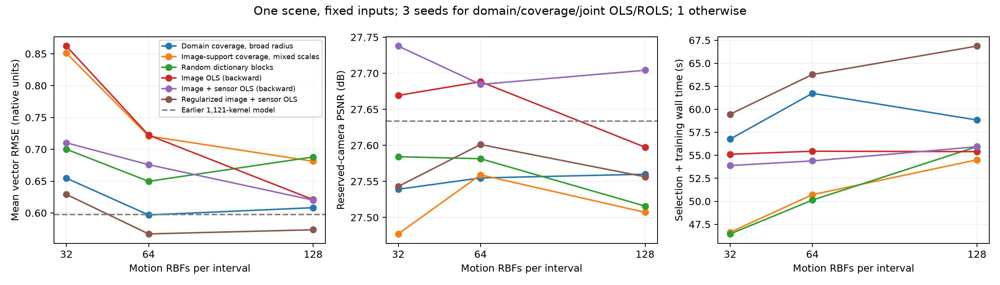

# RBF selection for dynamic Gaussian reconstruction: conclusions

Completed 2026-10-19. This is an exploratory results report, not a manuscript or submission.

**Regularized block selection improves the compact motion basis in this case; unregularized image-driven selection is inconsistent.** At 64 motion kernels per interval, regularized selection gives mean withheld vector RMSE **0.5670**, compared with **0.5968** for broad domain coverage: **4.99% lower error**. Both have three optimization repeats. The selected 64-kernel model also outperforms the earlier 1,121-kernel camera model (0.5974) while using **94.29% fewer motion kernels**. This does not mean 94% fewer appearance Gaussians, 94% smaller total checkpoints, or a 17-fold speedup.

**The successful mechanism is narrower than the original image-Jacobian hypothesis.** Removing image residual/Jacobian rows gives exactly the same regularized kernel sets at every budget. Candidate geometry still comes from training images. A direct sensor regression on the full image-derived dictionary scores **0.5595**, slightly better than the compact camera model. There is therefore no demonstrated best-in-class motion advantage from Gaussian rendering, and no evidence here that image-Jacobian scoring improves the winning selection.

## Experiment and primary comparison

The pinned official [LagrangianSplats implementation](https://arxiv.org/abs/2605.09299) is run on public ScalarSyn data: four frames, four training cameras, one reserved camera, a shared 6,097-Gaussian initial appearance model, and sixteen fixed simulated velocity-sensor locations with identical noisy readings. All nonlinear runs use 200 epochs. Kernels start with zero weights; centers, radii and weights are subsequently trainable. The candidate dictionary has 192 image-supported centers at three radii, giving 576 vector-kernel blocks. Selection changes the motion basis, not appearance-primitive pruning.

Scores below average vector RMSE across three velocity frames and, where repeated, across optimization seeds. All models use the same 4,096 withheld smoke-volume points per frame, more than two voxels from the sensors. Lower is better. All rows in this table have sensors during final reconstruction; 'image OLS' describes its selection objective only.

| Initializer | 32 kernels | 64 kernels | 128 kernels | Seeds |
|---|---:|---:|---:|---:|
| Broad domain coverage | 0.6546 | 0.5968 | 0.6082 | 3 |
| Image-support coverage, mixed scales | 0.8511 | 0.7208 | 0.6811 | 3 |
| Random dictionary blocks | 0.7001 | 0.6496 | 0.6879 | 1 |
| Image OLS (backward matrix) | 0.8621 | 0.7222 | 0.6209 | 1 |
| Joint image/sensor OLS | 0.7102 | 0.6758 | 0.6201 | 3 |
| Regularized joint selection | 0.6291 | 0.5670 | 0.5735 | 3 |

Regularized selection improves over broad domain coverage by 3.90%, 4.99% and 5.70% at the three budgets. Its 64-kernel repeat range is 0.567011–0.567048. These repeats share scene, geometry and measurements; their small spread is not independent-scene uncertainty. The 64-kernel budget is the best observed among three tested budgets, not an independently selected global optimum.

At 64 kernels, reserved-camera PSNR is 27.601 dB for regularized selection and 27.555 dB for broad coverage. Joint unregularized OLS has higher PSNR (27.685 dB) but worse motion (0.6758). Image scores and motion scores remain distinct outcomes.

The domain-coverage control and image-support coverage differ in both positions and support schedules. Their difference cannot be attributed solely to radius or solely to center placement. Joint OLS improves on the weaker same-dictionary coverage control, but loses to broad domain coverage at each budget.

## Image-only reconstruction

These runs have no velocity readings in selection or training and use seed 42 only.

| Initializer | 64 kernels | 128 kernels |
|---|---:|---:|
| Broad domain coverage | 0.8524 | 0.8356 |
| Image-support coverage, mixed scales | 0.8886 | 0.8577 |
| Image OLS (backward matrix) | 0.9047 | 0.8209 |

Image OLS is worse at 64 kernels and modestly better at 128. This is mixed evidence for the unregularized image-selection proposal, not a universal failure or success. The earlier 1,121-kernel image-only model averages 0.8693; comparison to it changes both count and initialization.

## Stronger controls and what they identify

The separate image-row ablation selects the same kernel sets at 32, 64 and 128; at 64/128 only their order changes. Consequently, the winning representation can be selected without computing the renderer Jacobian. This does not remove image information from candidate placement or from the downstream camera fit, and no duplicate reconstructions are counted for an unchanged basis set.

Direct linear regression using the same sensor readings and sensor-location CV gives:

| Direct velocity-fit basis | Motion RMSE |
|---|---:|
| Full image-derived bank, 576 kernels | 0.5595 |
| Selected 32 kernels, fixed full-bank ridge | 0.6003 |
| Selected 64 kernels, fixed full-bank ridge | 0.5808 |
| Selected 128 kernels, fixed full-bank ridge | 0.5646 |
| Three 576-kernel domain banks | 0.6079–0.7501 |

The full-bank ridge was chosen on held-out sensor locations, with all times/components at a location grouped together. Selected-subset fits retain that same absolute ridge and are not separately retuned. The domain banks use the same bounds, center count, radii and CV grid, with centers placed by farthest selection from uniform pools; their three pool seeds do not create three independent scenes. The earlier Gaussian-kernel sensor-only control scored 0.5967, so it was not the strongest sensor-only comparator for this follow-up. Three additional domain-coverage/support-CV fits are retained in the raw tables; their errors are 0.809, 0.790 and 0.759.

This supports investigating image-informed spatial allocation, but does not show that detailed morphology adds value beyond basic occupancy information. It also does not isolate a camera benefit: the full direct-regression bank beats every camera fit here, while the selected-subset comparisons vary by budget. Direct linear fits do not themselves provide rendered dynamic Gaussian scenes.

## Why regularization matters, and what it does not prove

The image-only and joint unregularized surrogates favor small-radius blocks and become ill-conditioned. At 128 blocks, independently recomputed condition numbers are approximately 3.3e11 and 1.3e8. The regularized augmented system has condition number about 3.3. Nine independent least-squares refits reproduce the recorded greedy objectives to relative error below 3.1e-11.

The regularized selector chooses its coefficient penalty by four-fold sensor-location CV on the full dictionary, then selects whole three-column vector blocks. It uses relative ridge 0.1 and normalized coefficient penalty 0.7572. That is a specified coefficient prior, not a physical energy norm or calibrated likelihood. Image and sensor row-count normalization also does not equalize their information: initial normalized target energies are 0.000622 and 0.738. The sensor term dominates regularized selection here.

Surrogate coefficients never initialize the nonlinear fits. Ill-conditioning therefore warns about the selection criterion but does not establish the cause of downstream errors. Greedy selection is not globally optimal. Conventional support-width CV selected the original broad-support rule at all budgets (32: 1×, 64: 1×, 128: 1×); identical initializers reuse existing fits.

## Numerical audit and retained failures

The original small-step finite-difference renderer check failed. Six reconstructions using that matrix remain labelled `finite_difference_pilot` and are excluded from primary plots. Their results are preserved rather than silently replaced. The backward-based matrix differs from the original matrix by 22.1% in Frobenius norm. Four independent backward-operator assembly checks agree within 4.5e-7 relative error; four kernel-parameter derivative probes and the analytic/GPU kernel comparison also pass.

The follow-up using float64 scalar-probe accumulation and the predeclared displacement 0.05 still fails the original 5% tolerance (probe errors 8.86%, 4.10%, 18.41%). The larger-step sweep is retained; the renderer discrepancy remains unresolved.

The primary unregularized selectors use the backward-based matrix. The regularized winning kernel sets are unchanged when all image rows are removed, which limits their dependence on this particular derivative approximation. See [the full protocol](PROTOCOL.md) for the chronological corrections and follow-ups.

## Cost, verification and limits

At 64 kernels, mean recorded optimization time is 32.25 seconds for regularized selection and 40.14 seconds for broad coverage. Once recorded selection and total training-process time are included, the corresponding means are 63.78 and 61.73 seconds. Startup, I/O and visualization overhead vary substantially; this is not a controlled end-to-end speed benchmark. Initial appearance training is shared and excluded. The original selector is charged its Jacobian/CV/selection cost even though the later ablation shows the Jacobian can be omitted.

The completed package contains **54 nonlinear camera fits** (six original finite-difference pilots), **162 common-target motion rows / 663,552 saved vector predictions**, and **216 reserved-camera frame scores**. Ten separate direct linear fits supply thirty frame rows / 122,880 vector predictions. All common-target, direct-regression and 162 secondary layout-specific motion losses are independently recomputed, sensor separation and actual kernel counts are checked, and every image aggregate is checked against its per-frame values. The combined research CPU suite passes 32 tests, including five selection tests. Artifact verification is distinct from the retained derivative failures.

These are one-scene, four-frame, reduced-budget experiments using simulated sensors and shared initial geometry. Repeated exploration of this development case is not a held-out final evaluation. No independent scenes, longer-window selected-basis tests, uncertainty calibration, or fully converged published benchmark reproduction have been established. No manuscript has been drafted.

## Connection to the thesis and next research decision

The actionable thesis contribution here is its treatment of **center selection, regularized OLS, support width and model compression** in Sections 2.4–2.6. The block implementation and nonlinear reconstruction experiments are new work in this repository; the mathematics of OLS, regularization and divergence-free kernels is established. The unavailable original MATLAB implementation has not been reproduced.

The next defensible research direction is **compact regularized motion bases allocated to observed spatial support**, evaluated against strong direct-regression controls on independent scenes and longer sequences. The present data favor that direction over an expensive unregularized image-Jacobian selector. They establish a useful pilot improvement, not a breakthrough, a new kernel, or a submission-ready general result.

Sources, equations and attribution: [METHOD.md](METHOD.md), [provenance](results/provenance.json), [full run summary](results/run_summary.csv), [paired comparisons](results/paired_comparisons.csv), [direct controls](results/linear_sensor_only_summary.csv), [verification](results/verification.json), and [reproduction commands](README.md).
